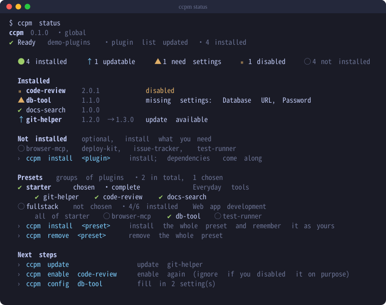

# ccpm

**A local, Web-first manager for Claude Code plugin marketplaces.**

[中文说明](README.zh-CN.md)

Claude Code can install plugins from a plugin marketplace, one at a time. `ccpm` sits on top of the
`claude plugin` commands and makes a whole marketplace easy to live with:

- **Local Web manager** — run `ccpm` to browse marketplaces, plugins and presets, then make every plugin
  change from the protected local page.
- **Maintenance CLI** — use `status`, `list`, `check`, `log`, `upgrade`, and `cc-update` for scripts and
  diagnostics; operational plugin commands live in Web.
- **Separate updates** — `ccpm upgrade` updates Plugin Manager itself, while `ccpm cc-update` safely updates
  npm-installed Claude Code and verifies it can start.
- **Sensitive settings** — values are passed only through `--values-stdin`, never command-line arguments,
  logs, or the browser activity feed.
- **Chinese / English** — follows your system language; force it with `CCPM_LANG=en` or `CCPM_LANG=zh`.

Web listens only on `127.0.0.1`, creates a fresh access token each time, and has no runtime dependencies.

## Requirements

- Node.js 18.11 or later
- [Claude Code](https://claude.com/claude-code) with the `claude` command on your `PATH`

## Install

```bash
npm install -g @kikilight/ccpm
```

The command is `ccpm`. To try it without installing: `npx @kikilight/ccpm`.

## Quick start

```bash
ccpm use owner/repo     # optional: set the marketplace used by status and list
ccpm                    # open the local Web manager
```

For script-friendly maintenance:

```bash
ccpm status             # installed plugins, updates, and configuration issues
ccpm upgrade            # update Plugin Manager itself
ccpm cc-update          # safely update Claude Code itself
```

If only one marketplace is added to Claude Code, ccpm uses it without `ccpm use`.



The screenshots come from a real run against a demo marketplace (`node scripts/screenshots.js` regenerates them).

## For marketplace authors

ccpm works with any Claude Code plugin marketplace. Two optional extras make it nicer:

**Presets.** Add `presets.json` at the root of the marketplace repository:

```json
{
  "formatVersion": 1,
  "presets": {
    "base": { "description": "Everyday tools", "plugins": ["gateway-mcp", "browser-mcp"] },
    "data": { "description": "Data team setup", "plugins": ["base", "db-tool", "data-scan"] }
  }
}
```

A preset lists plugin names and may include other presets by name (`data` includes everything in `base`).
Plugin dependencies are added automatically.

**Check in CI.** `ccpm check` validates every `plugin.json` and `presets.json` and exits 1 on problems:

```bash
npx @kikilight/ccpm check .
```

## Usage

<!-- usage:start -->
<!-- generated by node scripts/readme.js — do not edit by hand -->

```text
Claude Code Plugin Manager

ccpm manages Claude Code marketplaces, plugins, and settings through a local Web manager.
Run ccpm with no command to open it in a browser; all plugin changes are confirmed and run there.

Usage: ccpm [command] [options]

Common tasks:
  Manage plugins:       ccpm                         open the local Web manager
  First time:           ccpm use owner/repo          add or select a marketplace
  Check the state:      ccpm status
  List plugins:         ccpm list
  Update the manager:   ccpm upgrade
  Update Claude Code:   ccpm cc-update

Commands:
  web                    open the local Web manager (default)
  use [marketplace]      add or select the marketplace used by status/list
  status                 full state for the current marketplace
  list                   list plugins in the current marketplace
  upgrade                update Claude Code Plugin Manager (ccpm itself)
  cc-update [version]    safely update Claude Code itself
  check [folder]         check marketplace plugins and presets.json
  log                    show the diagnostic-log location
  help [command|topic]   show help, e.g. ccpm help cc-update

Options:
  --dry-run              preview updates or Web changes only
  -y, --yes              non-interactive; with no command, same as ccpm status
  --scope user|project   global (user, default) or current-project status/list scope
  --marketplace <name>   use another added marketplace for this status/list run
  --port <port>          Web server port (defaults to an available port)
  --no-open              do not open the browser after starting Web
  --tries <1-50>         maximum stable versions cc-update attempts (default: 5)
  --verbose              also print diagnostic logs to the screen
  -h, --help             show help; ccpm <command> --help shows command details

Safety:
  Sensitive settings travel only through --values-stdin, never argv, logs, or the page.
  Web listens only on 127.0.0.1 and creates a new access token every time it starts.

More help:
  ccpm help concepts         marketplaces, scopes, and update semantics
  ccpm help troubleshooting  common errors and fixes
```

### Commands in detail

#### ccpm web

```text
ccpm web — open the local Web manager

Purpose:
  Manage marketplaces, plugins, and settings in a browser. It is the only entry point for plugin changes.

Usage:
  ccpm web [--port <port>] [--no-open]

Arguments:
  none

Options:
  --port <port>          use this port (default: a random free port)
  --no-open              do not open the browser; print the link
  --dry-run              preview page changes only
  --scope user|project   initial page scope

Examples:
  ccpm
  ccpm web --no-open
  ccpm web --dry-run

What it does:
  1. Starts a token-protected page on 127.0.0.1 only
  2. Shows plugins, live activity, and results
  3. Confirms plugin changes and marketplace removal in the page

What it does not do:
  - Open anything to your network
  - Show or log tokens, passwords, or other sensitive settings
  - Change the CLI default marketplace

FAQ:
  Q: The browser did not open?
  A: Copy the printed link into a browser. It contains an access token, so do not share it.
```

#### ccpm use

```text
ccpm use — add or select the marketplace used by CLI queries

Purpose:
  Set the default marketplace for ccpm status and ccpm list. A Web-page choice does not change it.

Usage:
  ccpm use <source or name>
  ccpm use
  ccpm use --show

Arguments:
  <source or name>   GitHub owner/repo, git URL, local path, or an added marketplace name

Options:
  --show                 show only the selected marketplace

Examples:
  ccpm use owner/repo
  ccpm use ./my-marketplace
  ccpm use --show

What it does:
  1. Adds a marketplace when needed
  2. Saves the default used by status/list

What it does not do:
  - Install, update, or remove plugins
  - Delete other marketplaces

FAQ:
  Q: I only want to browse and manage plugins.
  A: Run ccpm and select a marketplace in the Web manager.
```

#### ccpm status

```text
ccpm status — full state for the current marketplace

Purpose:
  Print installed plugins, available updates, configuration issues, and preset state for scripts and diagnostics.

Usage:
  ccpm status

Arguments:
  none

Options:
  --scope user|project
  --marketplace <name>
  --verbose

Examples:
  ccpm status
  ccpm status --scope project
  ccpm --yes

What it does:
  1. Reads the marketplace and installed plugins
  2. Prints state and next steps

What it does not do:
  - Change plugins, settings, or marketplaces

FAQ:
  Q: How do I resolve a reported issue?
  A: Run ccpm and resolve it in the Web manager.
```

#### ccpm list

```text
ccpm list — list plugins in the current marketplace

Purpose:
  Print plugin names, versions, and installation state for scripts and quick inspection.

Usage:
  ccpm list

Arguments:
  none

Options:
  --scope user|project
  --marketplace <name>
  --verbose

Examples:
  ccpm list
  ccpm list --scope project

What it does:
  Reads and prints the current marketplace plugin list.

What it does not do:
  - Install, update, or change any plugin

FAQ:
  Q: How do I install or update a plugin?
  A: Run ccpm and use the Web manager.
```

#### ccpm upgrade

```text
ccpm upgrade — update Claude Code Plugin Manager

Purpose:
  Query npm for the latest ccpm version and, after confirmation, install it globally. This updates the manager, not Claude Code.

Usage:
  ccpm upgrade

Arguments:
  none

Options:
  --dry-run              show the version without installing
  -y, --yes              use the default confirmation

Examples:
  ccpm upgrade
  ccpm upgrade --dry-run

What it does:
  1. Queries npm for the latest package version
  2. Runs npm install -g after confirmation

What it does not do:
  - Update Claude Code itself
  - Manage plugins

FAQ:
  Q: How do I update Claude Code?
  A: Use ccpm cc-update or the Web Updates page.
```

#### ccpm cc-update

```text
ccpm cc-update — safely update Claude Code

Purpose:
  Update Claude Code installed globally by npm. The new version is verified; if all candidates fail, ccpm tries to restore the prior working version.

Usage:
  ccpm cc-update [version] [--tries <1-50>]

Arguments:
  [version]   an exact stable version (x.y.z); without one, start from the latest stable release

Options:
  --tries <1-50>         maximum stable versions to attempt; default: 5
  --dry-run              show candidates without installing
  -y, --yes              use the default confirmation

Examples:
  ccpm cc-update
  ccpm cc-update 2.1.112
  ccpm cc-update --tries 3 --dry-run

What it does:
  1. Queries npm for stable versions
  2. Installs each candidate and validates it with claude --version
  3. Tries to restore the original version if no candidate works

What it does not do:
  - Update ccpm itself (use ccpm upgrade)
  - Delete npm directories or change Claude Code auto-update settings

FAQ:
  Q: Can I do this from the page?
  A: Yes. Select Update Claude Code in the Web Updates page.
```

#### ccpm check

```text
ccpm check — check a marketplace

Purpose:
  For marketplace authors: validate plugin.json and presets.json against the format ccpm supports.

Usage:
  ccpm check [folder]

Arguments:
  [folder]   marketplace repository root; defaults to the current directory

Options:
  none

Examples:
  ccpm check
  ccpm check ../my-marketplace

What it does:
  Validates metadata, plugin references, and preset cycles; exits 1 for problems.

What it does not do:
  - Call Claude Code
  - Change files

FAQ:
  Q: Is a missing presets.json an error?
  A: No. Presets are optional.
```

#### ccpm log

```text
ccpm log — show the diagnostic-log location

Purpose:
  Print today’s log file and its directory for troubleshooting.

Usage:
  ccpm log

Arguments:
  none

Options:
  none

Examples:
  ccpm log

What it does:
  Prints paths only.

What it does not do:
  - Upload logs
  - Record sensitive-setting values

FAQ:
  Q: How long are logs retained?
  A: One file per day, for 14 days.
```

#### ccpm help

```text
ccpm help — show help

Purpose:
  Show the overview, command details, concepts, or troubleshooting guide.

Usage:
  ccpm help
  ccpm help <command>
  ccpm help concepts
  ccpm help troubleshooting

Arguments:
  <command>   web, use, status, list, upgrade, cc-update, check, log, help

Options:
  none

Examples:
  ccpm help cc-update
  ccpm help troubleshooting

What it does:
  Prints help only.

What it does not do:
  - Call Claude Code
  - Change anything

FAQ:
  Q: Where is help for plugin actions?
  A: Run ccpm and perform the action in the page.
```

### Concepts

```text
ccpm concepts

Web-first
  ccpm is a local Web manager. Plugin installation, updates, configuration, enable/disable, removal, and marketplace removal happen in Web;
  the command line keeps status, list, check, log, and maintenance commands for scripts and diagnostics.

ccpm upgrade vs ccpm cc-update
  ccpm upgrade updates Plugin Manager (ccpm) itself.
  ccpm cc-update updates Claude Code installed globally by npm. It verifies a new version and tries to restore the original version if needed.

Global vs current project (--scope)
  user (default) sees global installation; project sees plugins for the project in the current directory.

Sensitive settings
  Tokens and passwords travel only through --values-stdin, never through command-line arguments, logs, or Web activity.
```

### Troubleshooting

```text
ccpm troubleshooting (error → cause → fix)

claude command not found
  Install Claude Code, open a new terminal, and confirm with claude --version.

Cannot open the Web page
  Keep the terminal that runs ccpm open, then reopen the local link printed there.

cc-update cannot find Claude Code
  cc-update manages only globally npm-installed Claude Code. Check npm root -g and the npm package location.

Update failed
  Check the network and npm registry. Use --dry-run to inspect candidates first. cc-update tries to restore the prior version after candidate failures.

Reporting a problem
  Run ccpm log to find the log file. It contains no tokens or passwords.
```

<!-- usage:end -->

## Development

```bash
npm test                    # unit and integration tests (never runs the real claude)
node scripts/readme.js      # regenerate the Usage sections of both READMEs from the help text
```

Releasing: bump `version` in `package.json`, add a `CHANGELOG.md` entry, commit, then push a tag
`v<version>` (e.g. `git tag v0.1.1 && git push --tags`). The `publish` workflow runs the tests and publishes to npm.

## License

[MIT](LICENSE)
