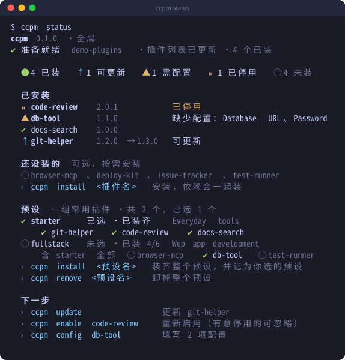

# ccpm

**面向 Claude Code 插件市场的本机 Web-first 管理器。**

[English](README.md)

Claude Code 可以从插件市场一个个地安装插件。`ccpm` 建立在 `claude plugin` 命令之上，让管理一整个 marketplace 变得省心：

- **本机 Web 管理器**：运行 `ccpm`，在受保护的本地页面中浏览 marketplace、插件和预设，并完成所有插件变更。
- **维护命令行**：`status`、`list`、`check`、`log`、`upgrade` 和 `cc-update` 面向脚本与诊断；插件操作在 Web 内执行。
- **分离的更新**：`ccpm upgrade` 更新 Plugin Manager；`ccpm cc-update` 安全更新 npm 安装的 Claude Code，并验证其能正常启动。
- **敏感配置**：只经 `--values-stdin` 传递，绝不出现在命令行参数、日志或浏览器活动记录中。
- **中英双语**：跟随系统语言；可用 `CCPM_LANG=zh` 或 `CCPM_LANG=en` 指定。

Web 仅监听 `127.0.0.1`，每次启动生成新的访问口令，没有任何运行时依赖。

## 环境要求

- Node.js 18.11 或更高
- [Claude Code](https://claude.com/claude-code)，并且 `claude` 命令在 `PATH` 里

## 安装

```bash
npm install -g @kikilight/ccpm
```

装好后的命令是 `ccpm`。不安装直接试用：`npx @kikilight/ccpm`。

## 快速开始

```bash
ccpm use owner/repo     # 可选：设置 status/list 默认使用的 marketplace
ccpm                    # 打开本机 Web 管理器
```

适合脚本的维护命令：

```bash
ccpm status             # 已装插件、可更新项与配置问题
ccpm upgrade            # 更新 Plugin Manager 自身
ccpm cc-update          # 安全更新 Claude Code 本体
```

Claude Code 里只添加了一个 marketplace 时，不运行 `ccpm use` 也会直接用它。



截图来自用演示 marketplace 的真实运行（`node scripts/screenshots.js` 可重新生成）。

## 给 marketplace 作者

ccpm 适用于任何 Claude Code 插件 marketplace。另外有两个可选的增强：

**预设。** 在 marketplace 仓库根目录放一个 `presets.json`：

```json
{
  "formatVersion": 1,
  "presets": {
    "base": { "description": "日常工具", "plugins": ["gateway-mcp", "browser-mcp"] },
    "data": { "description": "数据团队全套", "plugins": ["base", "db-tool", "data-scan"] }
  }
}
```

预设列出插件名，也可以按名字包含别的预设（`data` 包含 `base` 的全部）。插件的依赖会自动补上。

**在 CI 里校验。** `ccpm check` 校验每个 `plugin.json` 和 `presets.json`，有问题时退出码为 1：

```bash
npx @kikilight/ccpm check .
```

## 用法

<!-- usage:start -->
<!-- generated by node scripts/readme.js — do not edit by hand -->

```text
Claude Code Plugin Manager

ccpm 通过本机 Web 管理器统一管理 Claude Code 的插件市场、插件和配置。
直接运行 ccpm 会打开浏览器；所有插件变更都在 Web 中确认并执行。

用法: ccpm [命令] [选项]

常用场景:
  管理插件：        ccpm                         打开本机 Web 管理器
  第一次使用：      ccpm use owner/repo          添加或选择 marketplace
  查看当前状态：    ccpm status
  查看插件清单：    ccpm list
  更新管理器：      ccpm upgrade
  更新 Claude Code：ccpm cc-update

命令:
  web                    打开本机 Web 管理器（默认）
  use [marketplace]      添加或选择 status/list 使用的 marketplace
  status                 查看当前 marketplace 的完整状态
  list                   列出当前 marketplace 的插件
  upgrade                更新 Claude Code Plugin Manager（ccpm 自身）
  cc-update [version]    安全更新 Claude Code 本体
  check [目录]           校验 marketplace 的插件写法和 presets.json
  log                    显示诊断日志的位置
  help [命令|主题]       显示帮助，例如 ccpm help cc-update

选项:
  --dry-run              仅预览，不执行更新或 Web 中的变更
  -y, --yes              非交互模式；不写命令时等同 ccpm status
  --scope user|project   status/list 的全局（user，默认）或当前项目范围
  --marketplace <名字>   本次 status/list 使用另一个已添加的 marketplace
  --port <端口>          Web 服务端口（默认自动选择）
  --no-open              Web 启动后不自动打开浏览器
  --tries <1-50>         cc-update 最多尝试的稳定版本数（默认 5）
  --verbose              同时把诊断日志打印到屏幕
  -h, --help             显示帮助；ccpm <命令> --help 显示命令详情

安全:
  敏感配置只通过 --values-stdin 传递，不出现在命令行、日志或页面中。
  Web 仅监听 127.0.0.1，并为每次启动生成新的访问口令。

更多帮助:
  ccpm help concepts         marketplace、全局/当前项目与更新语义
  ccpm help troubleshooting  常见报错和解决办法
```

### 各命令详细说明

#### ccpm web

```text
ccpm web — 打开本机 Web 管理器

用途:
  在浏览器中管理 marketplace、插件和配置；这是所有插件变更的唯一入口。

用法:
  ccpm web [--port <端口>] [--no-open]

参数:
  无

选项:
  --port <端口>          指定端口（默认随机空闲端口）
  --no-open              不自动打开浏览器，只打印链接
  --dry-run              页面中的变更只预览
  --scope user|project   页面初始范围

示例:
  ccpm
  ccpm web --no-open
  ccpm web --dry-run

会做什么:
  1. 仅在 127.0.0.1 启动带一次性口令的网页
  2. 显示插件、活动过程和结果
  3. 在页面内确认安装、更新、配置、启停、卸载或删除 marketplace

不会做什么:
  - 不向局域网或外网开放
  - 不显示或记录 token、密码等敏感配置
  - 不修改命令行默认 marketplace

常见问题:
  问：浏览器没有自动打开？
  答：复制终端打印的链接到浏览器；链接含访问口令，勿分享。
```

#### ccpm use

```text
ccpm use — 添加或选择命令行查询的 marketplace

用途:
  为 ccpm status 和 ccpm list 设置默认 marketplace。Web 内的选择不会修改该默认值。

用法:
  ccpm use <地址或名字>
  ccpm use
  ccpm use --show

参数:
  <地址或名字>   GitHub owner/repo、git 地址、本地路径，或已添加的 marketplace 名字

选项:
  --show                 只显示当前选定的 marketplace

示例:
  ccpm use owner/repo
  ccpm use ./my-marketplace
  ccpm use --show

会做什么:
  1. 必要时添加 marketplace
  2. 保存 status/list 的默认选择

不会做什么:
  - 不安装、更新或卸载插件
  - 不删除其他 marketplace

常见问题:
  问：只想浏览和管理插件？
  答：直接运行 ccpm，在 Web 中选择即可。
```

#### ccpm status

```text
ccpm status — 查看当前 marketplace 的完整状态

用途:
  以纯文本报告已安装插件、可更新项、配置问题和预设状态，适合脚本和诊断。

用法:
  ccpm status

参数:
  无

选项:
  --scope user|project
  --marketplace <名字>
  --verbose

示例:
  ccpm status
  ccpm status --scope project
  ccpm --yes

会做什么:
  1. 读取 marketplace 和已安装插件
  2. 输出状态与下一步建议

不会做什么:
  - 不修改插件、配置或 marketplace

常见问题:
  问：如何处理报告中的问题？
  答：运行 ccpm，随后在 Web 管理器中处理。
```

#### ccpm list

```text
ccpm list — 列出当前 marketplace 的插件

用途:
  以纯文本列出插件、版本与安装状态，适合脚本查询。

用法:
  ccpm list

参数:
  无

选项:
  --scope user|project
  --marketplace <名字>
  --verbose

示例:
  ccpm list
  ccpm list --scope project

会做什么:
  只读取并输出当前 marketplace 的插件清单。

不会做什么:
  - 不安装、更新或修改任何插件

常见问题:
  问：如何安装或更新？
  答：运行 ccpm，在 Web 管理器中执行。
```

#### ccpm upgrade

```text
ccpm upgrade — 更新 Claude Code Plugin Manager

用途:
  查询 npm 中 ccpm 的最新版本；确认后全局安装该版本。仅更新管理器自身，不更新 Claude Code。

用法:
  ccpm upgrade

参数:
  无

选项:
  --dry-run              仅显示将安装的版本
  -y, --yes              使用默认确认

示例:
  ccpm upgrade
  ccpm upgrade --dry-run

会做什么:
  1. 查询当前 npm 包的最新版本
  2. 确认后执行 npm install -g

不会做什么:
  - 不更新 Claude Code 本体
  - 不管理插件

常见问题:
  问：要更新 Claude Code？
  答：使用 ccpm cc-update，或 Web 中的“更新 Claude Code”。
```

#### ccpm cc-update

```text
ccpm cc-update — 安全更新 Claude Code

用途:
  更新由 npm 全局安装的 Claude Code。安装后验证能否启动；候选版本失败时会尝试装回原可用版本。

用法:
  ccpm cc-update [version] [--tries <1-50>]

参数:
  [version]   指定稳定版本（x.y.z）；不写则从最新稳定版本开始尝试

选项:
  --tries <1-50>         最多尝试的稳定版本数，默认 5
  --dry-run              只显示候选版本，不安装
  -y, --yes              使用默认确认

示例:
  ccpm cc-update
  ccpm cc-update 2.1.112
  ccpm cc-update --tries 3 --dry-run

会做什么:
  1. 查询 npm 中的可用稳定版本
  2. 安装并执行 claude --version 验证
  3. 候选版本都不能启动时，尝试装回原版本

不会做什么:
  - 不更新 ccpm 自身（使用 ccpm upgrade）
  - 不删除 npm 目录或修改 Claude Code 自动更新配置

常见问题:
  问：页面上也能更新吗？
  答：可以，在 Web 的“更新中心”选择“更新 Claude Code”。
```

#### ccpm check

```text
ccpm check — 校验 marketplace 的写法

用途:
  面向 marketplace 作者，校验 plugin.json 和 presets.json 是否符合 ccpm 支持的格式。

用法:
  ccpm check [目录]

参数:
  [目录]   marketplace 仓库根目录，默认当前目录

选项:
  无

示例:
  ccpm check
  ccpm check ../my-marketplace

会做什么:
  校验元数据、插件引用和预设循环；有问题返回 1。

不会做什么:
  - 不调用 Claude Code
  - 不修改文件

常见问题:
  问：没有 presets.json 会失败吗？
  答：不会，预设是可选的。
```

#### ccpm log

```text
ccpm log — 显示诊断日志的位置

用途:
  显示今天的日志文件和日志目录，便于排查问题。

用法:
  ccpm log

参数:
  无

选项:
  无

示例:
  ccpm log

会做什么:
  只打印路径。

不会做什么:
  - 不上传日志
  - 不记录敏感配置的值

常见问题:
  问：日志保留多久？
  答：每天一个文件，保留 14 天。
```

#### ccpm help

```text
ccpm help — 显示帮助

用途:
  查看总览、命令详情、概念说明或排错指南。

用法:
  ccpm help
  ccpm help <命令>
  ccpm help concepts
  ccpm help troubleshooting

参数:
  <命令>   web、use、status、list、upgrade、cc-update、check、log、help

选项:
  无

示例:
  ccpm help cc-update
  ccpm help troubleshooting

会做什么:
  只打印帮助。

不会做什么:
  - 不调用 Claude Code
  - 不修改任何内容

常见问题:
  问：插件操作的帮助在哪里？
  答：运行 ccpm，在页面中直接操作。
```

### 概念说明

```text
ccpm 概念说明

Web-first
  ccpm 是本机 Web 管理器。插件安装、更新、配置、启停、卸载和 marketplace 删除都在 Web 内完成；
  命令行保留 status、list、check、log 和更新等适合脚本或维护的操作。

ccpm upgrade 与 ccpm cc-update
  ccpm upgrade 更新 Plugin Manager（ccpm）自身。
  ccpm cc-update 更新 npm 全局安装的 Claude Code；它会验证新版本，失败时尝试恢复原版本。

全局 vs 当前项目（--scope）
  user（默认）查看全局安装；project 查看当前目录项目的插件。

敏感配置
  token、密码等只经 --values-stdin 传递，永不出现在命令行参数、日志或 Web 活动记录中。
```

### 排错指南

```text
ccpm 排错指南（报错 → 原因 → 解决）

未找到 claude 命令
  安装 Claude Code，重新打开终端，再运行 claude --version 确认。

无法启动 Web 页面
  确认运行 ccpm 的终端仍在运行；复制终端中的本机链接重新打开。

cc-update 找不到 Claude Code
  cc-update 只管理 npm 全局安装的 Claude Code。检查 npm root -g 和 npm 包安装位置。

更新失败
  检查网络与 npm 源；可先用 --dry-run 查看候选版本。cc-update 会在候选版本失败后尝试恢复原版本。

反馈问题
  运行 ccpm log 找到日志文件；日志不含 token、密码。
```

<!-- usage:end -->

## 开发

```bash
npm test                    # 单元和集成测试（不会运行真实的 claude）
node scripts/readme.js      # 根据帮助文本重新生成两份 README 的“用法”一节
```

发布新版本：改 `package.json` 的 `version`、在 `CHANGELOG.md` 加一条，提交后推送标签 `v<版本号>`
（如 `git tag v0.1.1 && git push --tags`），`publish` 流程会跑测试并发布到 npm。

## 许可证

[MIT](LICENSE)
